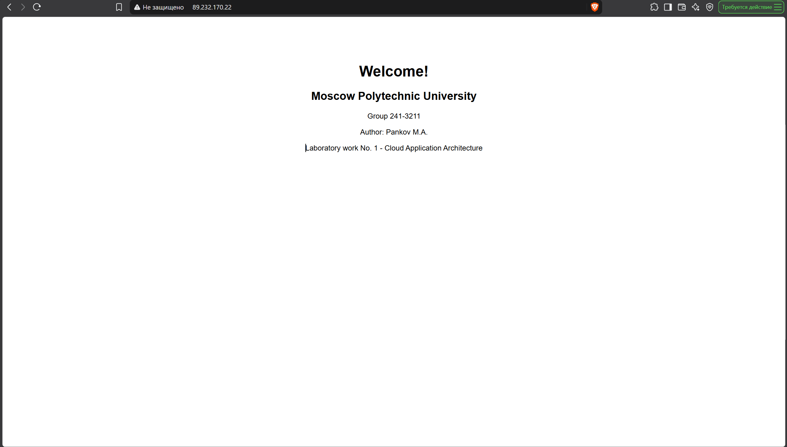

# ЛР1. Виртуальная машина в облаке и веб-сервер Apache

**Платформа:** Cloud.ru Evolution (вместо Yandex Cloud из-за ограничений квот, с разрешения преподавателя)
**Отчёт:** [Паньков-задание_1.docx](Паньков-задание_1.docx)

## Что сделано
1. Регистрация в Cloud.ru, стартовый грант 4000 бонусов.
2. Пара SSH-ключей Ed25519 (`ssh-keygen -t ed25519`).
3. Сервисный аккаунт `pankov-service-account`.
4. ВМ `pankov-vm`: Ubuntu 22.04, 1 vCPU, 1 ГБ RAM, диск 11 ГБ, подсеть с публичным IP, вход по ключу.
5. Подключение `ssh pankov@<публичный IP>`.
6. Apache2 и firewall:
   ```bash
   sudo apt update
   sudo apt install -y apache2
   sudo ufw allow OpenSSH
   sudo ufw allow 'Apache Full'
   sudo ufw enable
   systemctl status apache2
   ```
7. Правило группы безопасности облака: входящий TCP 80 от 0.0.0.0/0.
8. Приветственная страница [`index.html`](index.html) в `/var/www/html/`.

## Результат


Все скриншоты по шагам: [`screenshots/`](screenshots/) (01–20, в порядке рисунков отчёта).
